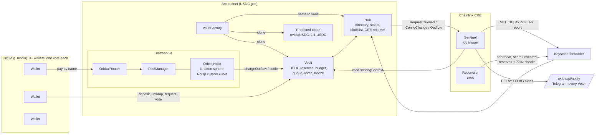

# palmfi

**Your keys can be stolen. Your treasury can't leave faster than your team can say no.**

palmfi gives every organisation a protected USDC vault on **Arc**. Small payments go out instantly within an Instant budget. Anything larger waits, and how long it waits depends on how unusual it is: **Chainlink CRE** scores each request against that wallet's and that vault's own history and sets the delay. During the delay, a majority of the org's own wallets can **veto** it or **fast-track** it. Orgs pay each other by name through one **Orbital pool** (Paradigm's N-token AMM) built as a **Uniswap v4 hook**.

Built at ETHGlobal Mumbai (Nov 5–7, 2026). Full design: [`brief.md`](brief.md) · decisions: [`docs/adr/`](docs/adr) · demo script: [`docs/demo.md`](docs/demo.md).

## Why

On Oct 29, 2026 attackers got an exchange's own signing infrastructure to sign for them, and billions left hot wallets in under an hour. The lesson: assume the attacker can produce **valid signatures**. palmfi limits what any one valid signature can do right now, and puts the rest behind a delay that the rest of the team controls. Unless more than half of an org's wallets are compromised, an attacker can't move more than the budget before someone can say no.

## How it works



1. **Deposit** USDC into the Vault and get the org's Protected token (`nvidiaUSDC`), which only moves between the org's own wallets and the pool.
2. **Within the Instant budget** (rolling 24h / 7d), unwrap or pay at once.
3. **Above it**, `requestUnwrap` / `requestPayment` queues the payment with a 1 USDC bond. It defaults to `MaxDelay` (72h) until the Sentinel scores it.
4. **The Sentinel** (CRE, log-triggered) reads the Vault's onchain baseline (the last 32 outflows, destination counts, business hours, wallet ages, pending config changes) and computes a **surprise score in bits** with pure integer math. The delay doubles every 2.5 bits from a 15-minute Floor; 28 bits or more (18 on the faucet-scale testnet demo), or a blocklisted destination, means **FLAG**: the Vault freezes and the destination is blocklisted. Routine payroll scores about 3 bits (about 30 min); a $3M payment at 3am to a new address scores about 30 bits (FLAG).
5. **Votes:** more than half of the other wallets saying NO cancels it; more than half of all wallets saying YES fast-tracks it to the Floor. Above the Hard cap, at least `CapDelay` (24h) applies unless fast-tracked.
6. **Pay another org by name** through the Orbital pool: you pay in your token, they receive theirs, and the swap-in is charged to your budget. The issuer settles foreign inventory back in USDC later.

Every Voter gets a Telegram alert on long delays, FLAGs and settings changes, so honest wallets are present to vote.

## Partner integrations

| Partner | What we built | Where |
|---|---|---|
| **Arc** | USDC-only treasury vaults; USDC gas; only the 6-decimal ERC-20 view of USDC is used (native `msg.value` is rejected); deployed and exercised live on Arc testnet; built, tested and audited in **Arc Studio** | [`contracts/src/Vault.sol`](contracts/src/Vault.sol), [`config/arc.json`](config/arc.json), [`docs/audits/`](docs/audits) |
| **Chainlink CRE** | Deterministic deviation scoring (milli-bit fixed point, no floats) to `SET_DELAY` / `FLAG` reports; log-triggered Sentinel, cron Reconciler (heartbeat, reserves, EIP-7702 delegation checks, catch-up scoring); Confidential HTTP notifications; failure-matrix simulation fixtures | [`cre/shared/deviation.ts`](cre/shared/deviation.ts), [`cre/sentinel/main.ts`](cre/sentinel/main.ts), [`cre/reconciler/main.ts`](cre/reconciler/main.ts), [`contracts/src/Hub.sol`](contracts/src/Hub.sol) (`onReport`) |
| **Uniswap v4** | N-token **Orbital** pool as one hook: every 2-token `PoolKey` is a facade over shared reserves held as ERC-6909 claims; `beforeSwap` NoOp custom curve (closed-form sphere trades, or the tick torus solved by bisection when LPs use tight ticks, see [`OrbitalTicks.sol`](contracts/src/orbital/OrbitalTicks.sol)); a payer's swap-in is charged to their Vault's budget; frozen tokens halt; deferred USDC settlement between issuers; own minimal router as trusted `msgSender()` | [`contracts/src/orbital/`](contracts/src/orbital) — [`registerToken`](contracts/src/orbital/OrbitalHook.sol#L128) (pair facades), [`_beforeSwap`](contracts/src/orbital/OrbitalHook.sol#L312) (NoOp curve + payer charge), [`quote`](contracts/src/orbital/OrbitalHook.sol#L287), [`addLiquidity(token, amount, tick)`](contracts/src/orbital/OrbitalHook.sol#L183), [`settle`](contracts/src/orbital/OrbitalHook.sol#L229), [`OrbitalMath`](contracts/src/orbital/OrbitalMath.sol); [`FEEDBACK.md`](FEEDBACK.md) |

## Deployed (Arc testnet, chain 5042002)

| Contract | Address |
|---|---|
| Hub | [`0x3cd22D98571884dC9d0692e520B5A7Aa4d95B22A`](https://testnet.arcscan.app/address/0x3cd22D98571884dC9d0692e520B5A7Aa4d95B22A) |
| VaultFactory | [`0x93bE1040670dAe5Fc89323fA611ee3CFC16aA169`](https://testnet.arcscan.app/address/0x93bE1040670dAe5Fc89323fA611ee3CFC16aA169) |
| OrbitalHook | [`0x41486F067436710330ab399c1D9f2394424b2888`](https://testnet.arcscan.app/address/0x41486F067436710330ab399c1D9f2394424b2888) |
| OrbitalRouter | [`0x973c94D3B45ad92d8DA6640cc950718e6248842b`](https://testnet.arcscan.app/address/0x973c94D3B45ad92d8DA6640cc950718e6248842b) |
| Vault impl / VaultModule / token impl | see [`deployments/arc.json`](deployments/arc.json) |

Uniswap v4 PoolManager on Arc: `0x1d70945634f618eefdf9edaadb59b9a183cef929`. USDC ERC-20: `0x3600000000000000000000000000000000000000`.

**Arc Studio project:** https://studio.arc.io/app/bd02f044-7cea-4167-b4b8-b41c3dc41502

## How we used Arc Studio and Circle tools

- **Arc Studio**, driven from Claude Code through the `arc-studio` CLI (`@circle-fin/arc-studio-cli`): we cloned this repo into a Studio app, and Studio built the Foundry project, ran the full test suite on an Arc fork, and ran a security review with runnable PoCs. All 8 PoCs reproduced against our code; we fixed 7 findings with regression tests ([`contracts/test/AuditFixes.t.sol`](contracts/test/AuditFixes.t.sol)) and recorded the rest as decisions ([`docs/audits/arc-studio-2026-11-06-resolution.md`](docs/audits/arc-studio-2026-11-06-resolution.md)). The contracts were then redeployed.
- **Circle USDC on Arc:** the Vault takes USDC through the ERC-20 interface only, so 18-decimal native gas and 6-decimal token amounts never mix. Test USDC from [faucet.circle.com](https://faucet.circle.com).

## Repo layout

| Path | What |
|---|---|
| `contracts/` | Foundry: `Vault` + `VaultModule` (delegatecall split for EIP-170), `VaultFactory`, `Hub`, `ProtectedToken`, `orbital/` (hook, router, math), `script/Deploy.s.sol` |
| `cre/` | Bun workspaces: `shared/` (deviation model, scoring, reports, chain reads), `sentinel/`, `reconciler/`, `fixtures/` (failure matrix) |
| `web/` | Next.js app: dashboard, votes with a per-term score breakdown, settings, incident view, pay by name, onboarding; `/api/notify` + Telegram |
| `config/arc.json` | Shared Arc addresses for contracts, CRE and web |
| `deployments/arc.json` | Our deployed addresses (synced into CRE configs and the web app) |

## Run it

Requirements: Foundry, Bun, pnpm, Node 22, the [CRE CLI](https://docs.chain.link/cre) for simulation.

```bash
cp .env.example .env    # ARC_RPC_URL
```

**Contracts** (tests fork Arc testnet):
```bash
cd contracts && forge test
```

**CRE** (unit tests, then a live simulation against a real queued request):
```bash
cd cre && bun install && bun run test && bun run typecheck
```
```bash
cd cre && bun shared/scripts/live-request.ts known
```
```bash
cd cre && cre workflow simulate sentinel --target staging-settings --non-interactive --trigger-index 0 --evm-tx-hash <hash> --evm-event-index 1
```
`live-request.ts` needs `CRE_ETH_PRIVATE_KEY` in `cre/.env` and about 20 test USDC on that wallet. Add `--broadcast` to the simulation to write the report onchain through Arc's simulation forwarder. `bun run simulate` runs the failure-matrix fixtures.

**Web:**
```bash
cd web && pnpm install && pnpm dev
```
Open http://localhost:3000, connect a wallet on Arc testnet, onboard an org with at least 3 wallets.

**Deploy your own:** `forge script script/Deploy.s.sol --rpc-url $ARC_RPC_URL --account <keystore> --broadcast`, then `bun cre/scripts/sync-config.ts` and `pnpm --dir web sync:deployments`.

## Tests

- Contracts: 75 Foundry tests on an Arc fork (lanes, votes, changes, whitelist, Orbital swaps / settlement / fuzz, audit regressions); every contract under 24 KB.
- CRE: 124 tests (deviation model calibration, scoring outcomes, Sentinel and Reconciler handlers, the brief's §7.4 failure matrix).
- Web: 26 tests (helpers, notify fan-out, Telegram linking, a drift test that keeps the UI's copy of the scoring model identical to the Sentinel's).

## Known limitations (testnet)

- The testnet Hub trusts CRE's **simulation forwarder** so the demo can run through `cre workflow simulate --broadcast`; anyone can forge reports to it. Production pins the Keystone forwarder and the workflow identity (`Hub.pinWorkflow`).
- Veto needs a majority of the non-requester wallets: an offline honest wallet counts against the veto. Alerts to every Voter exist to keep them present.
- The Orbital pool implements Paradigm's ticks (nested spherical caps, boundary ticks consolidated onto a circle, interior onto one sphere: the torus invariant), with ten price-floor ticks per LP choice. It keeps a 20× virtual concentration so unevenly funded pools stay on the curve; ticks are measured on those virtual reserves as price bands. The Arc deployment predates `OrbitalTicks` (needs a redeploy to carry it).
- Passkey voters for Individuals are deferred.
